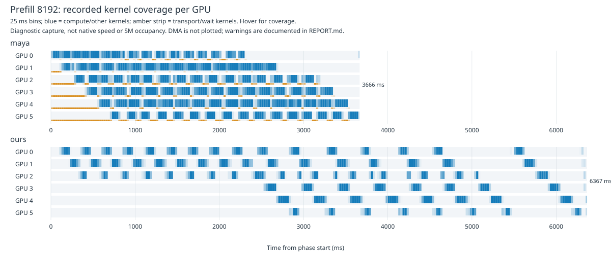

# Maya и наш runtime: телеметрия на новой платформе, 2026-11-05

**Анализ завершён. Главный подтверждённый кандидат для prefill - реальное перекрытие вычислений между GPU. Для TG выявлены дробление verification и дорогая шеститокенная ветка; полный critical path TG пока не установлен.** Runtime source, defaults и пользовательские файлы Maya не изменены. Commit/push не выполнялись.

Чистая скорость измерена отдельно: [native серия новой машины](../1017-maya-newhost-20261105/REPORT.md). Её результаты не заменяются timings под Nsight. Старые CPU/материнская плата/RAM/GPU order не являются baseline.

## Условия и состояние захватов

Те же binaries и source HEAD `91c88beb2`, Threadripper PRO 3945WX, 12 CPU threads, 192 GB RAM, шесть GPU в новом UUID/PCI порядке. Те же десять SSD GGUF Q3 с MXFP8 Engram, TopK=2048, context=100352, наш B8192/U512/P1/Q8_0 KV, fixed GPU-only expert overrides, expert cache=0/staging=0. Maya использует собственные KV и expert placement. Один и тот же sidecar: файл с BF16 в имени фактически содержит преимущественно MXFP4 payload; подробности в native отчёте. K5/full/p-min=0.5/cumulative=0, 128 greedy выходных токенов, TG нормирован на 127 decode intervals. Input IDs те же; cache_n/reused=0 проверены.

Nsight Systems 2025.3.2: CUDA, NVTX, node-level CUDA Graph trace, cudaProfilerApi capture ranges. Внешний interposer ставит границы prefill/first output/generation/drain и периодически снимает стеки CUDA API. Наш дополнительный interposer помечает target/draft decode, ubatch, proposal и feature bridge. Production code не менялся, eval callback не использовался. `DS4_PROF` намеренно не включён: его event/mutex instrumentation может менять перекрытие Maya. `DS4_CPU_STATS=1` имеет ограничение ниже.

| Захват | Контроль до/после | Состояние |
| --- | --- | --- |
| Maya 8K | pre/profile/post | Полный ответ, захват и оба контроля сохранены |
| Maya 98K | pre/profile, без post | Ответ 128 токенов завершён; трасса восстановлена, ограничения ниже |
| Наш 8K | pre/profile/post | Полная последовательность |
| Наш 98K | pre/profile/post | Полная последовательность, процесс exit 0 |

Первый Maya controller имел STOP timeout 120 s. После полного `DONE` на 98K запись большой трассы не успела завершиться, затем cleanup controller убил wrapper Nsight по timeout 180 s. Это ошибка harness после ответа, не установленная авария GPU. Исходный [results.json](artifacts/results.json) сохранён с `complete=false`, error и forced-kill; его нельзя считать полностью успешной серией. Offline importer завершился, обе SQLite экспортированы. Сохранены [recovery](artifacts/recovery.json), [восстановленный ответ 98K](artifacts/maya/recovered98k.json), raw qdstrm и diagnostics. Для 98K Maya нет post-control и per-phase CPU/I/O counters. Исправленный отдельный controller нашего runtime сохранял ответ до STOP и ждал до 900 s; [его manifest](artifacts/ours-results.json) завершён, 9 запросов, два захвата, exit 0.

## 1. Prefill: работа действительно перекрывается

Вычислительные интервалы определены как записанные GPU kernels за исключением Maya `xfer_get`, `xfer_put`, `wait_flags` и аналогичных transport/wait kernels. Среднее число GPU = сумма объединённых интервалов каждого GPU / длительность фазы. Условное среднее использует только время, когда хотя бы один GPU исполнял такое ядро. Это **не SM occupancy**, не NVML utilization и не полная оценка critical path. Memcpy/DMA в эту метрику не входят.

| Prefix | Движок | Profile PP wall, ms | Среднее вычисляющих GPU за всю фазу | Когда идёт вычисление | Записанные kernels PP |
| --- | --- | ---: | ---: | ---: | ---: |
| 8192 | Maya | 3666.10 | 3.258 | 3.333 | 113218 |
| 8192 | Наш | 6367.17 | 1.127 | 1.325 | 57808 |
| 98304 | Maya, recovered | 40905.15 | 3.887 | 3.926 | 1365894 |
| 98304 | Наш | 73557.99 | 1.202 | 1.363 | 613025 |

[SVG с hover-подсказками](artifacts/prefill8k-timeline.svg) показывает покрытие 25 ms bins записанными kernels, отдельно transport/wait strip. Белый участок означает отсутствие таких записей, а не доказанный простой всей карты.

Это согласуется с исходниками и sampled stacks Maya: `forward_chunks -> run_dev_chunks -> layer_chunk/flow_layer` исполняются workers разных GPU, каждый продвигает свой chunk. `forward_chunks` отправляет работу всем device workers; обмен идёт через buffers/flags. У нас лог подтверждает `asynchronous pipeline inputs = enabled, copies=4` для target. Поэтому проблема не сводится к выключенному флагу pipeline: **разрешённый pipeline даёт существенно меньше фактического перекрытия**.

У Maya в этой раскладке prefill НЕ пропускает верхние 20 слоёв: `hc_post_inplace_kernel` вызван 1280 раз на 8K = 16 chunks x 40 layers x 2 и 15360 раз на 98K = 192 x 40 x 2. Это согласуется с guard `yoco_layer()`, который не допускает такой skip для distributed suffix при активном flow. Наш runtime, напротив, сообщает `prefill_skip` с KV-only source=20 и сохранённым хвостом. Поэтому ускорение Maya здесь нельзя приписать только skip; сравнение стоимости одного слоя всё равно требует учёта разных KV/attention/arithmetic и placement.

Maya делает БОЛЬШЕ kernel launches PP, но заканчивает раньше. Следовательно, свести её преимущество к меньшему числу CUDA launches или одному FP16 GEMM неверно. В трассе есть Q3 `set_tc_kernel`, light kernels и FP16 paths; долю ускорения каждого из них этот опыт не изолирует.

## 2. TG: главный участок нашего профиля - target verification

На 8K у обоих движков условное число одновременно вычисляющих GPU около 1.0. Сырой показатель Maya, считающий все kernels, гораздо выше из-за polling/transport. Это не параллельное исполнение математики на всех картах при decode.

| Метрика захвата TG, 128 outputs | Наш 8K | Maya 8K | Наш 98K | Maya 98K, recovered |
| --- | ---: | ---: | ---: | ---: |
| NVTX wall, ms | 4311.15 | 2057.17 | 4037.34 | 2218.43 |
| Записанные kernels | 241911 | 95562 | 227334 | 109122 |
| `cudaStreamSynchronize`, calls | 7627 | 136 | 7230 | 150 |
| `cudaEventSynchronize`, calls | 1077 | 0 | 1078 | 0 |
| `cudaGraphInstantiate`, calls | 591 | 0 | 645 | 0 |
| Условное среднее вычисляющих GPU | 1.000 | 1.000 | 1.007 | 1.001 |

Counts относятся к этой трассе, не к одинаковому teacher-forced выходу. Maya не обязана использовать CUDA Graph; отсутствие Instantiate у неё не означает отсутствие ускоренного исполнения. `cuKernelGetName` и часть служебных вызовов добавлены инструментарием. Суммы API/GPU ms разных threads/devices не складываются в wall time.

Корреляция CUDA API с нашими NVTX scopes относит записанные kernels TG8K: target 1692.81 GPU-ms, draft 207.00 GPU-ms, bridge outer 0.10 GPU-ms. TG98K: target 1516.16, draft 186.72, bridge outer 0.07 GPU-ms. Это сумма времени kernels, не длительность host scope; она указывает приоритет target, но не измеряет native цену полного bridge или scheduler.

На host target decode scopes занимают около 3484/3247 ms в этих двух захватах. `proposal.generate` - 362/326 ms, `bridge.generation` - 74/64 ms. Scopes вложены: draft decode входит в proposal, injection входит в bridge; складывать все эти значения нельзя. Prefill bridge scope также может ожидать ещё выполняющийся target: его ~1 s на 8K не является ~1 s вычисления drafter, у которого записано лишь ~2.5 GPU-ms KV seeding.

### Конкретная граница: anchor + пять draft = шесть queries

В [llama-graph.cpp](../../../../src/llama-graph.cpp) `is_dsv41_verify_batch(kv_only)` разрешает до 6 только для KV-wide; обычный matmul/MoE guard остаётся 5. [deepseek41.cpp](../../../../src/models/deepseek41.cpp) при выходе за этот guard строит MoE по query, floating matmul также сохраняет раздельный single-query путь. Это действующие численные ограничения, не ошибка INI.

| Target queries | 8K calls | 8K median host scope, ms | 98K calls | 98K median host scope, ms |
| --- | ---: | ---: | ---: | ---: |
| 1 | 4 | 64.50 | 20 | 55.42 |
| 2 | 9 | 63.69 | 9 | 63.85 |
| 3 | 7 | 66.89 | 1 | 60.81 |
| 4 | 12 | 66.19 | 7 | 62.10 |
| 5 | 6 | 73.31 | 4 | 66.17 |
| 6 | 9 | 139.67 | 9 | 121.28 |

Шесть queries заметно дороже в обоих захватах. Однако их 9 samples не являются matched микро-A/B: позиции, cache state и capture overhead различаются. Следующий кандидат - специальный шеститокенный путь с сохранением reduction/rounding/causal masks/rollback, а не увеличение guard без проверки. Для чистой проверки стоимости нужны одинаковые prefix и shapes 1..6.

Стековые samples нашего TG указывают `ggml_backend_sched_compute_splits` с `buffer_set_tensor` и event synchronization. Это реальные места для более узких counters, но периодические samples не дают time shares. У Maya рабочие стеки ведут в `run_dev`/flow, draft и verify. Доля CPU expert math из них не установлена.

## 3. Instrumentation overhead и CPU/I/O

Здесь pre/post - uncaptured запросы того же процесса под Nsight с установленными probes, а не чистая native серия. Чистый benchmark не имел ни Nsight, ни interposer. В таблице TG за 127 intervals.

| Движок | Prefix | PP pre / profile / post, t/s | TG pre / profile / post, t/s |
| --- | ---: | --- | --- |
| Maya | 8192 | 2267.74 / 2236.30 / 2263.73 | 67.15 / 61.74 / 68.88 |
| Наш | 8192 | 1343.82 / 1301.23 / 1340.41 | 42.40 / 29.51 / 41.10 |
| Maya | 98304 | 2482.28 / 2404.63 / нет | 63.30 / 57.25 / нет |
| Наш | 98304 | 1380.96 / 1340.11 / 1382.65 | 43.26 / 31.71 / 43.17 |

Наш TG под capture падает примерно на 27-29% против bracketing controls, Maya8K - примерно на 9%. Поэтому нельзя объявлять recorded 52% отсутствия GPU activity доказанными 52% native idle или переносить host durations из профиля в обещание ускорения.

У нашего 8K pre/profile/post за полный запрос major faults: 25 / 22900 / 22, read_bytes: 0.10 / 95.65 / 0.09 MB. На98K: 19 / 79120 / 16, read_bytes 0.08 / 320.82 / 0.07 MB. `/proc` счётчики включают injected Nsight/probes и все mappings процесса: адреса faults не снимались, поэтому **приписывать эти faults Engram нельзя**. Они подтверждают вмешательство инструментария в captured workload.

Maya8K pre/profile/post читает 2.78 / 2.84 / 3.18 GB; используются pread/flow и отдельный row cache, поэтому её read_bytes и major faults нельзя напрямую сравнивать с mmap как число одинаковых lookup. На этой машине часть CPU/host работы связана с чтением, dispatch и ожиданиями, а не обязательно с CPU FFN.

В capture8K процесс Maya тратит около 21.42 CPU-s до первого output и 4.08 CPU-s после; наш - 6.40 и 4.56 CPU-s. Эти числа включают instrumentation и все threads. Большая загрузка CPU Maya согласуется с device workers/flow, но сама по себе не доказывает более быстрые CPU expert kernels.

`DS4_CPU_STATS` здесь выводит нули/NaN для phase timings: GGUF IQ path возвращается через `cpu_experts_mx -> cpu_experts_iq` до старого instrumented пути, а его `run_nodes` вызывается без phase. **Нулевые timings не означают отсутствие CPU вычислений.** Счётчики calls остаются наблюдаемыми; фазовую цену CPU экспертов по этому выводу оценивать нельзя.

## Ограничения трасс и проверка идентичности

- Kernel perf CPU IP sampling запрещён текущим `perf_event_paranoid=4`; системные настройки не менялись. OSRT запрошен, но не собран. CPU flamegraph, off-CPU stacks и полный critical path не получены.
- Nsight сообщает `Not all NVTX/CUDA events might have been collected`; такие warnings наблюдались и в отдельном малом smoke. У нашего runtime дополнительно 42/42 GraphId/GraphNodeId errors на8K и 1775/1775 на98K. Они сохранены, их нельзя скрыть успешным SQLite export.
- Все ЗАПИСАННЫЕ kernels сопоставились с CUDA API. На PP8K counts обычных launch APIs также сходятся с kernel records. Это проверка внутренней связности записей, а не доказательство отсутствия потерянных events. Особенно ограничены graph topology и оценки отсутствующей GPU activity в TG.
- Maya98K дополнительно имеет timeout ожидания окончания recording. Phases имеют start/end, ответ DONE полон, но clean post-control отсутствует; этот захват только дополнительная диагностическая опора к полноценному8K.
- Граница PP/TG ставится client по первому output, а не точным device fence. У нас она позже reported PP примерно на71ms на8K. Одна proposal может попасть в PP. Drain после ответа вынесен отдельно.
- Maya8K pre/profile/post output hashes различаются; у нашего runtime pre/profile/post совпадают на8K и98K. Это не quality/NLL/state/rollback gate. Разные continuations, KV formats и placement ограничивают прямое сравнение acceptance и отдельных kernels.
- Profiler изменил Maya admission на четыре target experts: CPU lane157 вместо153 native (GPU15203 вместо15207). Это небольшой, но реальный workload delta. В startup Maya сама отвергла часть сохранённых fresh lane timings и перекалибровалась; это сохранено в log, старые hardware timings не использовались.

Sampled minimum free VRAM: Maya865.125MiB, наш1259.25MiB, floor512 не нарушен. Наш процесс завершился exit0 без CUDA/OOM/allocation warnings. Оригинальный Maya controller завершился нештатно по описанному timeout; не выдавать это за exit0. После анализа собственных GPU compute processes не осталось. [Проверка hashes](artifacts/after-checks.json) подтверждает неизменность libraries/source/user Maya files; HEAD прежний, checkout `my_maya`. Runtime source/defaults не правились.

## Что делать дальше

1. **Prefill:** узкий native опыт на lifetime/input/copy/event зависимости между chunks512. Сначала измерить длительности fences и фактическое продвижение нескольких chunks без Nsight node tracing; затем проектировать bounded ownership для повторного использования graph/input/feature buffers. Сохранить shapes/addresses/copy slots/KV writes/taps/failure rollback. Не удалять synchronize глобально: он защищает живые входы и копии.
2. **TG:** counters-only проверка target sizes1..6 на одинаковом prefix без CUPTI/backtrace и сравнение K3/K4/K5 full. Проверить, сколько Instantiate/scheduler waits существует в native, до оптимизации graph retention. Отдельный шеститокенный MoE/float путь допускается только после численных/state/rollback gates; изменение политики K не смешивать с kernel A/B.
3. После этого повторить чистые PP512/8K/98K, TG, VRAM и quality gates. Acceptance drafter проверять на одинаковом prefix, а не по процентам разных generated ответов. В native98K у нас acceptance77.72% выше Maya75.61%, но TG ниже: приоритет одной только acceptance этим не подтверждается.

Это профиль и план следующих кандидатов, не реализация ускорения и не решение о переносе Maya целиком.

## Артефакты

[Сводка](artifacts/summary.json), [config](artifacts/config.json), [первый runner](artifacts/run.py), [исправленный runner](artifacts/run-ours.py), [analysis](artifacts/analyze.py), [NVTX scopes](artifacts/scopes.py), [interposer](artifacts/control.cpp), [target/draft scopes](artifacts/roles.cpp), [sampled symbols Maya](artifacts/maya/symbols.json), [sampled symbols наши](artifacts/ours/symbols.json), [SVG generator](artifacts/plot-svg.py), [checksums/locators](artifacts/SHA256.json).

Полные `.nsys-rep`, `.sqlite`, recovered `.qdstrm` и compiled probes хранятся локально в этой persistent artifacts directory и исключены из Git. Контрольные суммы и точные пути входят в manifest. Small raw protocols/logs, probe sources, summaries и harness доступны в каталоге. Heavy offline analysis выполнялся после завершения controls; источники результатов не смешаны с прежней машиной.
